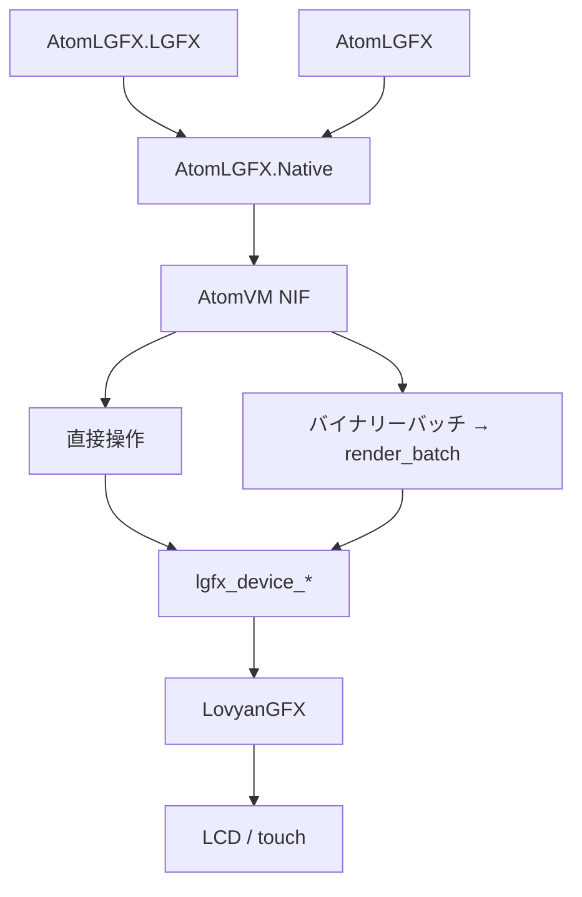

# 構成

内部を変更する開発者向けの文書です。使い始める場合は [Getting Started](getting-started.md)、
API の選択と使用例は [Elixir パッケージ](elixir-package.md) を参照してください。

## 実行経路



直接呼び出しとバッチは同じ装置層を使います。現在の実行経路は NIF のみです。

## 各層の責務

| 層 | 担当 | 担当しないこと |
| --- | --- | --- |
| `lib/` | 公開 API、入力の正規化、色表現、バッチ符号化 | LovyanGFX の呼び出し |
| `native/nif.c` と NIF 実装 | AtomVM 項の変換、引数・対象・状態の再検証、戻り値生成 | 描画ロジック |
| `native/render_batch.cpp` | バッチの解析と装置操作への振り分け | 別系統の描画実装 |
| `native/device/` | 初期化、対象解決、図形・文字・画像・スプライト・タッチ | AtomVM 項の解析 |

`AtomLGFX.LGFX` の頻出操作は専用 NIF、`AtomLGFX` は主に操作番号・対象・フラグ・引数を渡す共通 NIF を使います。
操作番号と検証情報の定義元は `native/include/atom_lgfx/ops.def` です。

## 所有権と生存期間

- ネイティブの LCD 装置は単一実体です。
- `AtomLGFX.LGFX.init/0` は構築時設定、`AtomLGFX.LGFX.init/1` は実行時設定を使います。
- `AtomLGFX.open/1` は設定ハンドルを作ります。機器の初期化は `init/1` が行います。
- ハンドルの設定と実行時キャッシュはプロセス辞書にあり、作成したプロセスから使います。
  不明または別プロセスのハンドルでの `init/1` は `{:error, :invalid_handle}` を返します。
- `close` はネイティブ機器とスプライトを終了します。
- 文字列、JPEG、RGB565、バッチのバイナリーは NIF 呼び出し中だけ借用します。
  ネイティブ側は呼び出し終了後にそのポインターを保持しません。
- スプライト転送は、外側の書き込み区間が続いていても転送先の `waitDMA()` を待って戻ります。
  バッチ内でも次の命令で転送元を変更・解放できる同期動作を維持します。
  PSRAM の表示用短冊も、転送完了後に再利用します。

## 設定の流れ

```text
CMake の LGFX_PORT_* 設定
  → native/cmake/lgfx_port_config.h.in
  → <build>/generated/atom_lgfx/lgfx_port_config.h
  → 初期化の既定値
```

実行時に変更できる値は `AtomLGFX.LGFX.init/1` または `AtomLGFX.open/1` → `init/1` で上書きします。
ESP-IDF の PSRAM・フラッシュ設定や組み込む機能はファームウェア構築時に決まります。

## 関連文書

- [ESP-IDF 部品](esp-idf-component.md): 構築と設定
- [操作契約](protocol.md) / [生成された操作参照](protocol-reference.md): 内部形式と検証規則
- [ネイティブ実装](../native/README.md) / [装置層](../native/device/README.md): ファイルごとの担当
